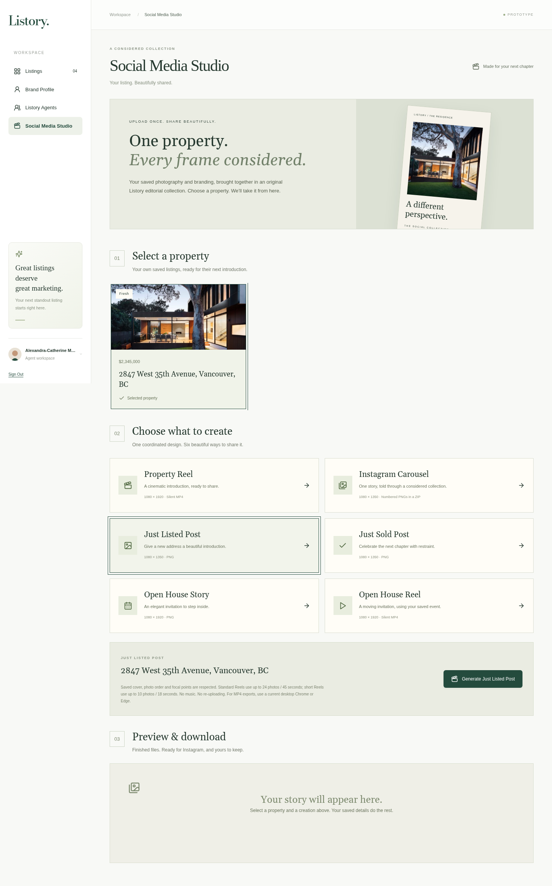
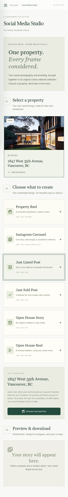
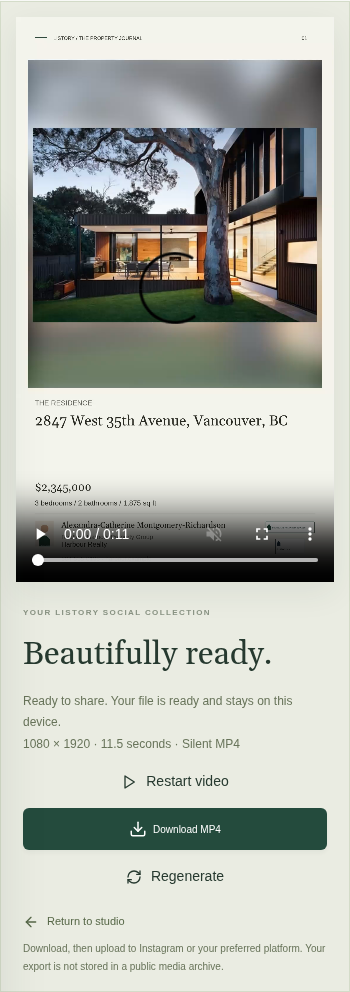
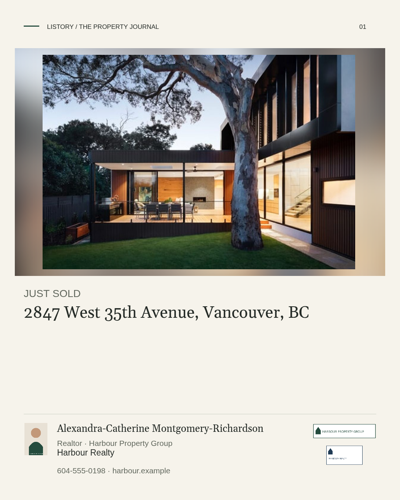
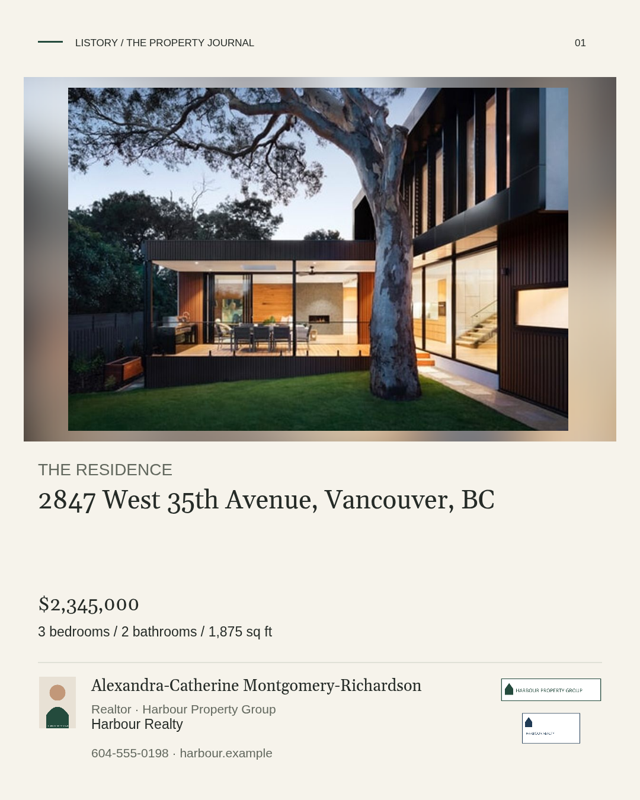
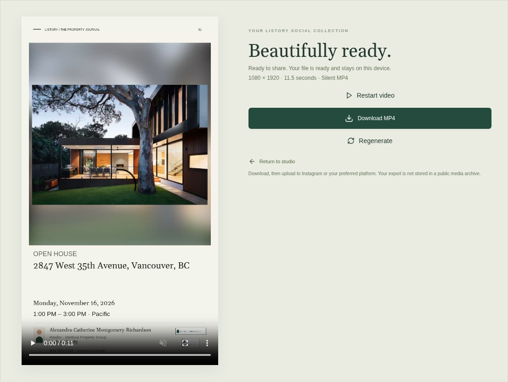
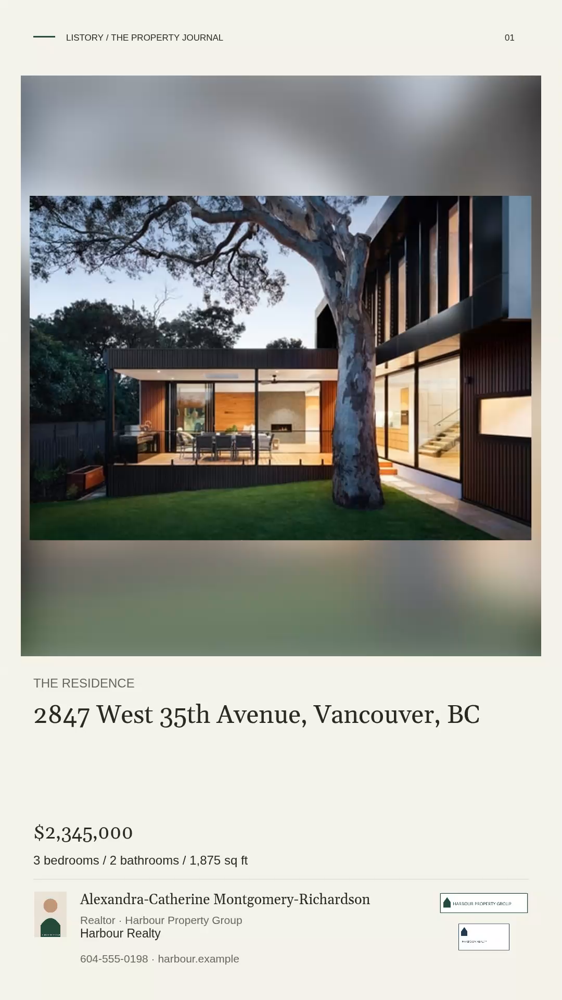
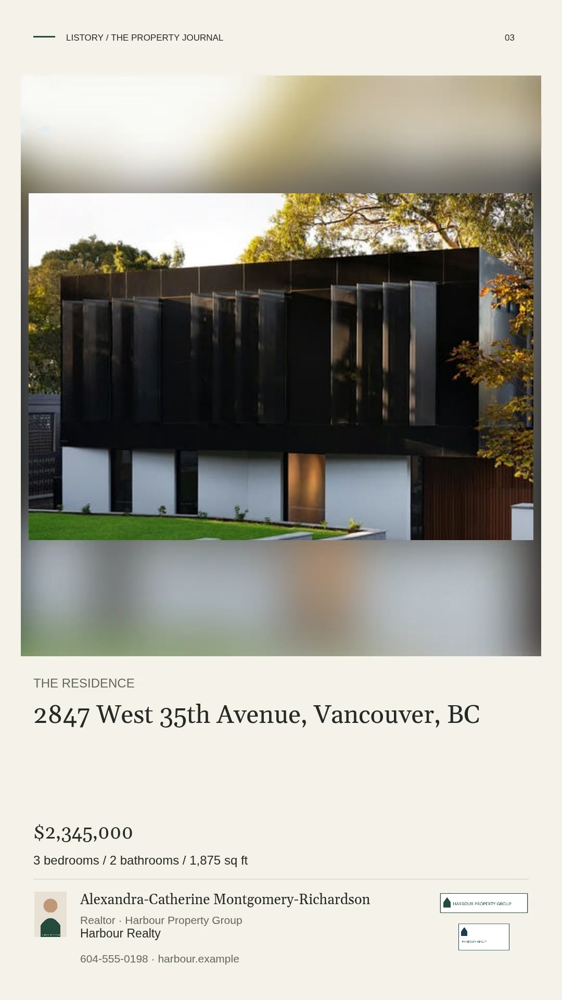
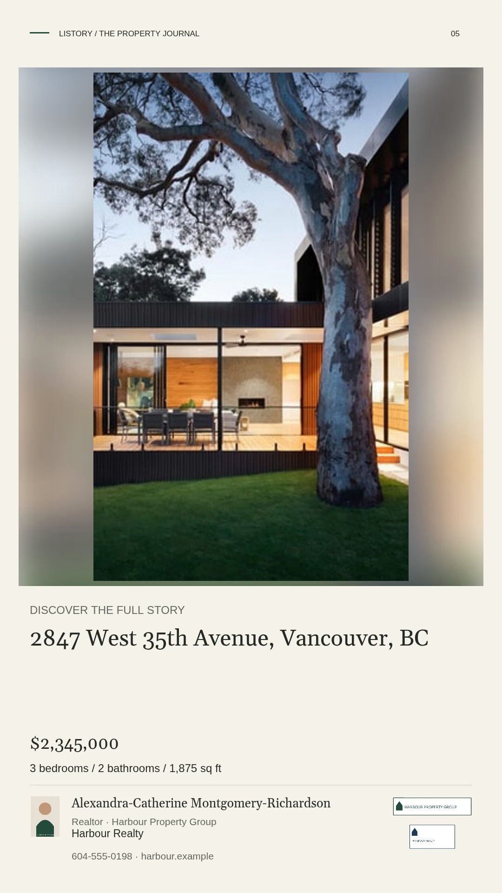

# Social Media Studio — design and file review

These are **fictional test listings and branding**, using existing demonstration
photography. They do not represent the pictured property, a live sale or actual
Open House advertising. Real exports use the signed-in owner's listing and
actual saved Brand Profile; the application has no fallback demonstration agent.

## Download actual example files

- [Property Reel — native 1080 × 1920 MP4](property-reel.mp4)
- [Instagram Carousel — ZIP of eight numbered 1080 × 1350 PNGs](carousel.zip)
- [Video codec/dimension/duration verification](video-verification.json)

The MP4 is the actual downloaded H.264 file, 24 fps, 11.5 seconds and silent.
It was played in Chromium and independently decoded with FFmpeg. It is not an
HTML animation, screen recording or renamed WebM. Both Reel types use this same
encoding pipeline. Test event dates are fictional fixture data.

## Private workspace

## Mobile workspace

## Native exported images

| Just Listed | Just Sold |
|---|---|
|  |  |

| Carousel cover | Carousel interior |
|---|---|
|  |  |

### Open House Story

## Finished Reel previews

These screenshots show the players using the finished downloadable MP4s.

| Property Reel | Open House Reel |
|---|---|
|  |  |

### Frames decoded from the native Property Reel

| Opening | Middle | Ending |
|---|---|---|
|  |  |  |

Inspect the MP4 itself for the gentle motion and dissolves. Check the carousel
ZIP outside Listory and review your own real branding/photographs in the feature
Preview before approving a merge. No Production release is authorized yet.
